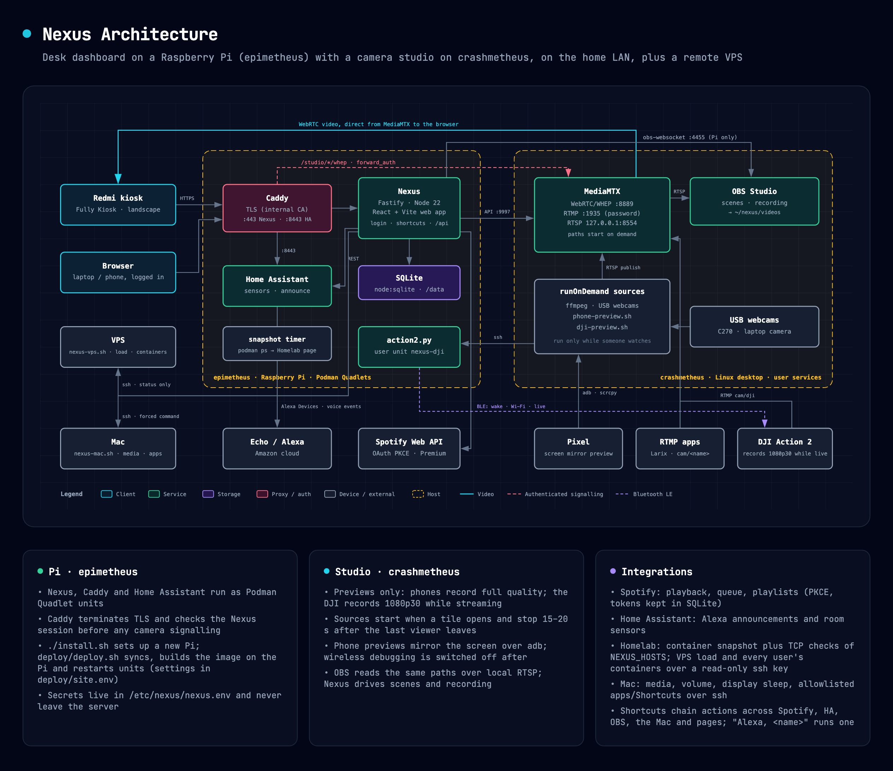

# Nexus

Desk dashboard on a Raspberry Pi: Spotify remote, clock and timers, shortcuts, Home Assistant (Alexa), homelab status,
and a camera Studio with OBS control. React + Vite web app served by a Fastify server (SQLite via `node:sqlite`, Node 22).

## Architecture



Interactive version: [docs/architecture.html](docs/architecture.html) (open it in a browser; the `⋯` menu exports PNG or PDF).

- **epimetheus (Pi)** runs Nexus, Caddy and Home Assistant as Podman Quadlet units, deployed with `deploy/deploy.sh`.
  Caddy terminates TLS and forwards camera signalling to MediaMTX only for logged-in sessions.
- **crashmetheus** runs the Studio: MediaMTX (`deploy/studio/install.sh`) and OBS (`deploy/studio/obs-setup.sh`).
  Camera paths start on demand when a tile opens and stop after the last viewer leaves. Previews only: phones and the
  DJI Action 2 record full quality themselves.
- **Cameras:** USB webcams on crashmetheus, phones mirrored over adb (`phone-preview.sh`), anything that streams RTMP
  to `rtmp://crashmetheus/cam/<name>`, and the DJI Action 2, which the Pi starts over Bluetooth (`pi/action2.py`,
  driven by `dji-preview.sh`).

## Environment

| Var | Required | Notes |
|---|---|---|
| `NEXUS_PASSWORD` | yes | Login password. Server refuses to start without it. |
| `SESSION_SECRET` | yes | Signs the session cookie (use 32+ random chars). |
| `SPOTIFY_CLIENT_ID` | for Spotify | PKCE, no client secret. |
| `PUBLIC_URL` | for Spotify | e.g. `https://epimetheus.lan`; redirect URI is `PUBLIC_URL/api/spotify/callback`. |
| `NEXUS_CONTAINERS_FILE` | no | `podman ps -a --format json` snapshot written by a host timer, default `/run/nexus/containers.json`. |
| `NEXUS_HOSTS` | no | Hosts to TCP-check: `name=host:port,...` e.g. `nas=192.168.31.10:22`. |
| `HA_URL` | for Alexa | Home Assistant base URL, e.g. `http://homeassistant:8123`. |
| `HA_TOKEN` | for Alexa | HA long-lived access token (secret, never returned by the API). |
| `HA_SENSORS` | no | Comma-separated allowlist of entity ids shown on Devices, e.g. `sensor.echo_dot_temperature,weather.home`. The dashboard shows the first `weather.*` entity and the first °C sensor as room temperature. |
| `HA_ANNOUNCE_ENTITY` | for announce | notify entity, e.g. `notify.living_room_amey_s_echo_dot_announce` (Alexa Devices integration). |
| `HA_VOICE_ENTITY` | for voice | The Echo's voice event entity, e.g. `event.<echo>_voice_event` (Alexa Devices). "Alexa, <shortcut name>" then runs that shortcut. Add an Alexa routine with the same phrase (action: "Alexa says OK") so the Echo doesn't answer "I don't know that". |
| `STUDIO_API` | for Studio | MediaMTX API origin on the camera host, e.g. `http://192.168.31.247:9997`. |
| `STUDIO_CAMERAS` | no | Optional `Name=path` list: display names, and tiles kept visible while offline, e.g. `DJI Action 2=cam/dji`. Other cameras are discovered from MediaMTX. Unquoted (podman env-file). |
| `OBS_URL` | no | obs-websocket on crashmetheus, e.g. `ws://192.168.31.247:4455`. Set up with `deploy/studio/obs-setup.sh`. |
| `OBS_PASSWORD` | with OBS_URL | From `~/.config/nexus-studio/obs.pass` on crashmetheus. Never returned by the API. |
| `PORT` | no | default 3000 |
| `NEXUS_DATA_DIR` | no | SQLite location, default `./data` (`/data` in the image) |

## Local dev

```
pnpm install
NEXUS_PASSWORD=dev SESSION_SECRET=dev-secret-dev-secret-dev-secret pnpm dev   # web on :5173 (proxies /api to :3000), server on :3000
pnpm typecheck && pnpm test && pnpm build
```

Production: `pnpm build`, then `node apps/server/dist/index.js` (serves `apps/web/dist`). Container: `podman build -f Containerfile -t nexus .`, mount a volume at `/data`.
The server sets `Secure` cookies only when the request is HTTPS (`trustProxy` is on, so run it behind your reverse proxy).

## Spotify app setup

1. Create an app at https://developer.spotify.com/dashboard.
2. Add the redirect URI `PUBLIC_URL/api/spotify/callback`. Spotify requires HTTPS for non-loopback redirect URIs.
3. Put the Client ID in `SPOTIFY_CLIENT_ID`, then use Settings > Connect Spotify.
4. Playback control needs a Spotify Premium account.

## Home Assistant (Alexa bridge)

Runs as the `homeassistant` container on the Pi, reachable only over HTTPS at
`https://192.168.31.128:8443` (via Caddy; no plain-HTTP port is published).

One-time setup on a fresh volume: HA 2026.x keeps HTTP settings in
`/config/.storage/http` (YAML `http:` is ignored once migrated). With HA stopped, set
`"use_x_forwarded_for": true` and `"trusted_proxies": ["10.89.0.0/24"]` under
`data.stable`, then start it. Without this, requests through Caddy return 400.

Then: onboard in the HA UI, add the built-in Alexa Devices integration (log in to Amazon there),
create a long-lived token (Profile → Security), and set in `.env`:
`HA_URL=http://homeassistant:8123`, `HA_TOKEN`, `HA_ANNOUNCE_ENTITY` (e.g.
`notify.<echo>_announce`) and optionally `HA_SENSORS`.

## Studio: adding a camera

Every Studio tile is a MediaMTX path on crashmetheus. Nexus lists whatever MediaMTX has, so most cameras need no
Nexus change. Re-running `deploy/studio/install.sh` restarts MediaMTX, which briefly cuts any preview in progress.

- **USB webcam on crashmetheus:** plug it in and re-run `deploy/studio/install.sh`. Each webcam gets a path named
  after the device (e.g. `c270-hd-webcam`) that only runs while someone watches.
- **Android phone (preview by screen mirroring; the phone records full quality itself):**
  1. Give the phone a fixed DHCP lease so it resolves as e.g. `oneplus.lan`.
  2. Pair it once from crashmetheus over adb wireless debugging (`adb pair <ip>:<port>` with the pairing code).
  3. Add a line `oneplus oneplus.lan` to `~/.config/nexus-studio/phones` and re-run `install.sh`. The tile is `phone/oneplus`.
  4. Before each preview, turn on wireless debugging and open the Camera app. Wireless debugging is switched off
     again when the preview stops (the Developer options "Wireless debugging" quick tile makes this one tap).
- **Anything that streams RTMP or RTSP** (Larix, IP cameras, OBS elsewhere): publish to
  `rtmp://<crashmetheus>/cam/<name>?user=studio&pass=<publish password>`. The password is in
  `~/.config/nexus-studio/publish.pass` on crashmetheus. Use the two-part `cam/<name>` form; most apps require it.
  The tile appears while the camera is streaming.
- **A camera that has to be woken first** (like the DJI Action 2): add a `runOnDemand` script like
  `deploy/studio/dji-preview.sh` and a block for it in `install.sh`. For the DJI, put the Pi's ssh target
  (e.g. `user@epimetheus.lan`) in `~/.config/nexus-studio/dji` and the stream URL in `~/.config/nexus-studio/dji.url`
  (mode 600) on the Pi.
- **Optional, fixed name and a tile that stays visible while offline:** add `Name=path` to `STUDIO_CAMERAS` in
  `/etc/nexus/nexus.env` on the Pi (e.g. `Front Door=cam/front-door`), then `sudo systemctl restart nexus`.
- **In OBS:** add a Media Source with input `rtsp://127.0.0.1:8554/<path>`.
